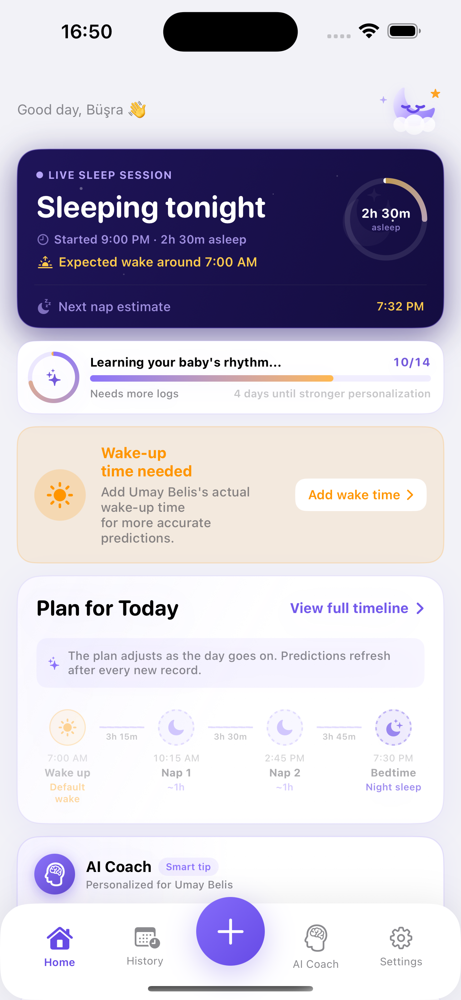
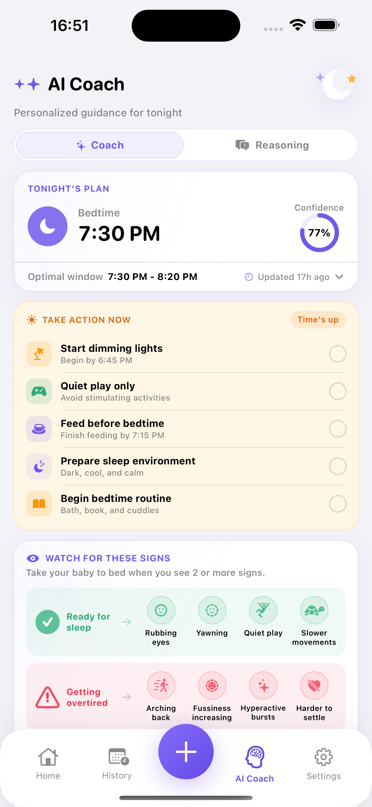
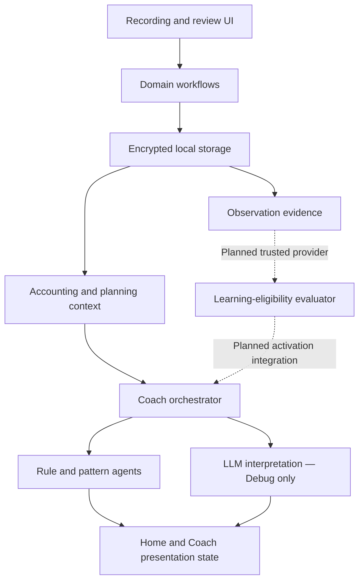

# SleepCoach.AI

**A native SwiftUI baby sleep tracker with a rule-based coaching architecture.**

SleepCoach.AI brings together sleep logging, daily guidance, and historical review in a calm interface for parents. Its engineering focus is the reliability of the information behind each recommendation: the domain model distinguishes recorded events, parent-confirmed coverage, routine assumptions, and missing data.

The app is in active development. Sleep tracking, evidence-review workflows, encrypted local storage, and the learning-eligibility foundation are implemented. Verified eligibility is not yet connected to the complete personalized coaching flow. Production cloud AI and subscription purchase support remain planned work.

[Getting started](#getting-started) · [Architecture](#architecture) · [Personalization status](#personalization-status) · [Testing](#testing-and-continuous-integration)

## Interface previews

<p align="center">
  
  
</p>

These previews show an earlier development build. Recording and review interfaces continue to evolve.

## Current capabilities

- **Sleep and wake recording:** log naps, night sleep, morning wake times, and awake intervals within a sleep session. Keep a session ongoing until its end is recorded.
- **Daily guidance:** view the current sleep state, a compact plan, bedtime guidance, and sleep summaries on the Home dashboard.
- **History and corrections:** inspect past records, edit sleep information, and recover missing or incorrect historical morning wake observations.
- **Daytime coverage review:** inspect a day's naps, add or correct records, explicitly confirm coverage—including a day with no naps—and withdraw an earlier answer.
- **Consistent night completion:** use an observed night-sleep end as the corresponding morning wake information through the recording workflow.
- **Local profiles and storage:** create a local parent/baby profile, keep private data in an encrypted vault, and delete local data from Settings.

The recording, historical-wake, and coverage-review flows are implemented in the [recording workflow](BabySleepTracker/Services/SleepRecordingFlow.swift), [wake workflow](BabySleepTracker/Services/SleepWakeTimeWorkflow.swift), and [daytime review model](BabySleepTracker/ViewModels/DaytimeCoverageReviewModel.swift).

## Engineering highlights

### Sleep accounting with explicit boundaries

Night sleep belongs to the Sleep Day on which it starts, even when it continues past midnight. A separate rolling 24-hour calculation measures sleep within a moving time window.

Accounting merges overlapping intervals and subtracts valid attached awake intervals. Provisional or incomplete totals remain distinguishable from comparable completed totals. Planning can use an observed wake, a completed nap boundary, or a routine fallback while retaining the source and uncertainty of that information.

An unresolved session does not become a confirmed observation simply because time has passed. Analytics do not turn an assumed wake time into a recorded wake event.

See [sleep accounting and overview calculations](BabySleepTracker/Services/SleepOverviewCalculator.swift), [sleep state and planning context](BabySleepTracker/Services/SleepStateCalculator.swift), and the [orchestrator](BabySleepTracker/Services/SleepCoachOrchestrator.swift).

### Reviewable evidence and historical corrections

The observation layer tracks provenance, record revisions, night-to-wake links, and the evidence associated with a parent's coverage confirmation. Confirmation refers to a particular set of records and boundaries. Relevant edits invalidate earlier confirmation and require a fresh review.

Coverage and timestamp verification are separate concerns: confirming that all naps were recorded does not independently verify each nap's start and end. Missing coverage also remains distinct from an explicit zero-nap confirmation.

Recovery logic preserves unfinished recording operations and prevents failed writes or stale review state from silently granting trust.

See [observation provenance and recovery](BabySleepTracker/Services/ObservationProvenance.swift) and the [daytime review interface](BabySleepTracker/Views/DaytimeCoverageReviewView.swift).

### Deterministic guidance and controlled language generation

Protocol-based agents handle phase information, sleep patterns, daytime and nighttime guidance, nap transitions, and rule-based insights. `SleepCoachOrchestrator` combines their outputs into shared presentation state.

The LLM integration adds natural-language interpretation over the structured analytics. Request identity, cancellation, stale-result checks, permission state, and storage generations constrain when an asynchronous result can be published or cached.

Direct Gemini requests are available only in configured, consented **Debug** builds. **Release** builds disable those requests until a production service is implemented; local tracking and deterministic guidance remain available.

See the [orchestrator](BabySleepTracker/Services/SleepCoachOrchestrator.swift), [LLM agent](BabySleepTracker/Services/SleepCoachLLMAgent.swift), and [cloud AI privacy boundary](BabySleepTracker/Services/CloudAIPrivacy.swift).

## Personalization status

The intended personalization model requires **at least seven recent, sufficiently valid recording days** before the first personalized assessment. Those days need not be consecutive. Elapsed calendar time and the number of dates containing records are insufficient on their own.

| Component | Current status |
| --- | --- |
| Trusted observation capture and correction | Implemented, including provenance, historical wake recovery, and parent-confirmed daytime coverage. |
| Learning-eligibility evaluator | Implemented as a pure domain component. It evaluates evidence quality, day boundaries, integrity, and recency using a versioned policy. |
| Verified eligibility in the live coaching flow | Pending integration. The evaluator does not itself activate predictions, change the UI, or grant subscription access. |
| First personalized assessment | Intended to be available without purchasing Premium once sufficient valid data exists; the complete delivery lifecycle is pending. |
| Premium coaching and detailed predictions | Purchase and entitlement integration remain planned work. |

The current Coach still contains a separate [legacy 14-day phase/readiness model](BabySleepTracker/Agents/Implements/PhaseAgent.swift). The seven-valid-day evaluator has not yet replaced that tracked-day logic.

Basic recording and initial guidance form the free entry experience. This is not an Apple subscription free trial, and recording does not automatically enroll a user in a subscription.

The [eligibility model](BabySleepTracker/Models/LearningEligibility.swift) and [evaluator](BabySleepTracker/Services/LearningEligibilityEvaluator.swift) define the implemented foundation. The [product decisions](docs/PRODUCT_DECISIONS.md) record the intended commercial model; implementation-status sections in that document refer to their stated historical baseline.

## Architecture

The app uses an MVVM-inspired SwiftUI architecture. Views own presentation state and coordinate domain workflows, while focused calculators, persistence adapters, and protocol-based agents provide testable boundaries.



Solid lines summarize current runtime responsibilities. Dotted connections show the verified-eligibility integration still to be completed; the evaluator itself already exists.

| Area | Main responsibility |
| --- | --- |
| `BabySleepTracker/Views/` | Home, recording sheets, review flows, history, explanations, and settings. |
| `BabySleepTracker/ViewModels/` | Focused presentation and review state, including daytime coverage review. |
| `BabySleepTracker/Models/` | Sleep and wake records, evidence types, and eligibility policy/results. |
| `BabySleepTracker/Services/` | Accounting, planning context, recording workflows, provenance, persistence, privacy, and orchestration. |
| `BabySleepTracker/Agents/` | Protocols and implementations for deterministic analysis and guidance. |
| `BabySleepTrackerTests/` and `BabySleepTrackerUITests/` | Domain, persistence, orchestration, and native interaction regressions. |

**Technology:** Swift, SwiftUI, Foundation, CryptoKit, Keychain, Swift concurrency, XCTest/XCUITest, Swift Package Manager, and the Google Generative AI Swift SDK. `NotificationCenter` coordinates existing record-change refresh flows; non-sensitive preferences remain in `UserDefaults`.

## Privacy and local storage

Personal profiles, sleep records, observation metadata, recovery information, and cached coaching use an authenticated **AES-GCM encrypted vault** with its key stored in **Keychain**. Vault writes are atomic, and the iOS storage implementation requests Complete file protection.

- Locked, unreadable, or corrupt storage is surfaced as unavailable rather than replaced with an empty history.
- Cloud sharing requires explicit, revocable permission in supported development builds. Revocation also prevents an older in-flight result from repopulating private coaching state.
- Cloud prompts omit direct identifiers such as names, exact birth dates, and photos; the remaining sleep information is still treated as personal data.
- Settings provides a confirmed local-data deletion flow and an explanation of actual data use.
- Onboarding creates a **local profile**. Remote authentication and cloud synchronization are not implemented.

Hardware-specific file protection, lock/unlock behavior, and encrypted backup restoration require physical-device verification before distribution. See [security and data handling](docs/SECURITY.md) for the implementation boundaries and outstanding release checks.

## Getting started

### Requirements

| Requirement | Configuration |
| --- | --- |
| Development host | macOS with Xcode. |
| iOS deployment target | iOS 16.2. |
| Language mode | Swift 5 language mode. |
| Dependency management | Swift Package Manager; committed versions are in `Package.resolved`. |
| CI reference environment | Xcode 16.4, iOS Simulator 18.5, and the `macos-15` runner. |
| CI simulators | iPhone 16 Pro and iPhone SE (3rd generation). |

The CI toolchain is a reference environment, not a claim about the minimum supported Xcode version. Build settings are defined in the [Xcode project](BabySleepTracker.xcodeproj/project.pbxproj); the [package lockfile](BabySleepTracker.xcodeproj/project.xcworkspace/xcshareddata/swiftpm/Package.resolved) pins external dependencies.

```bash
git clone https://github.com/busrayildiiz/SleepCoach.AI.git
cd SleepCoach.AI
open BabySleepTracker.xcodeproj
```

1. Allow Xcode to resolve the Swift packages.
2. Select the **BabySleepTracker** scheme and an installed iOS simulator.
3. Run the app and create a local profile.

Local tracking and deterministic guidance do not require a cloud-provider credential. Optional Debug cloud coaching follows the configuration and consent boundaries in [SECURITY.md](docs/SECURITY.md); provider credentials must not be embedded in the distributed app.

## Testing and continuous integration

The shared [BabySleepTracker scheme](BabySleepTracker.xcodeproj/xcshareddata/xcschemes/BabySleepTracker.xcscheme) includes both XCTest and XCUITest targets. In Xcode, use **Product → Test** or **⌘U** with the selected simulator.

For an installed simulator matching CI's standard destination:

```bash
xcodebuild test \
  -project BabySleepTracker.xcodeproj \
  -scheme BabySleepTracker \
  -configuration Debug \
  -sdk iphonesimulator \
  -destination 'platform=iOS Simulator,name=iPhone 16 Pro,OS=18.5' \
  -parallel-testing-enabled NO
```

Substitute an available destination when using another simulator/runtime. Native app and simulator tests require macOS and Xcode.

Regression coverage includes accounting across midnight, awake intervals, unresolved sessions, morning-wake synchronization, evidence invalidation, historical corrections, storage failures, privacy permissions, and important recording/review interactions.

The CI workflow provides:

- **Draft feedback:** app-hosted XCTest on the standard simulator. Passing this tier does not satisfy the merge gate.
- **Full validation:** the shared scheme on standard and compact simulators for ready PRs, main updates, and configured merge/release/manual events.
- **Explicit UI checkpoints:** native UI evidence during draft iteration, bound to the selected PR revision.
- **Reviewable artifacts:** result bundles, logs, summaries, and screenshots for UI/full validation.
- **CodeQL:** analysis of Swift, GitHub Actions, Python, and JavaScript/TypeScript.

Current results are available in [iOS CI](https://github.com/busrayildiiz/SleepCoach.AI/actions/workflows/ios-ci.yml) and [CodeQL](https://github.com/busrayildiiz/SleepCoach.AI/actions/workflows/codeql.yml). See the [workflow configuration](.github/workflows/ios-ci.yml), [reusable native runner](.github/workflows/ios-test.yml), and [CI guide](docs/CI.md) for routing, gates, and evidence access.

## Next milestones

1. Complete the Home/History review experience and integrate the trusted evidence provider with learning eligibility.
2. Deliver the first personalized assessment and connect verified eligibility to the relevant coaching and prediction decisions.
3. Implement the production AI service and Premium purchase/entitlement lifecycle.
4. Validate the complete parent journey through interface refinement, physical-device checks, and a focused beta before App Store preparation.

Cloud synchronization, expanded reporting, and broader longitudinal analytics remain future product work.

## Project documentation

- [Security and data handling](docs/SECURITY.md)
- [CI workflows and validation](docs/CI.md)
- [Product decisions](docs/PRODUCT_DECISIONS.md)
- [Architecture map](docs/ARCHITECTURE.md)
- [Dashboard extraction notes](docs/architecture/sleep-list-view-refactor.md)
- [Repository contribution instructions](AGENTS.md)

Some detailed documents preserve implementation snapshots from earlier revisions. Their dated status sections should be read alongside the current source.

## Author

**Büşra Kalay** — Software Engineer · iOS Developer

[LinkedIn](https://www.linkedin.com/in/busrakalay/) · [GitHub](https://github.com/busrayildiiz)
